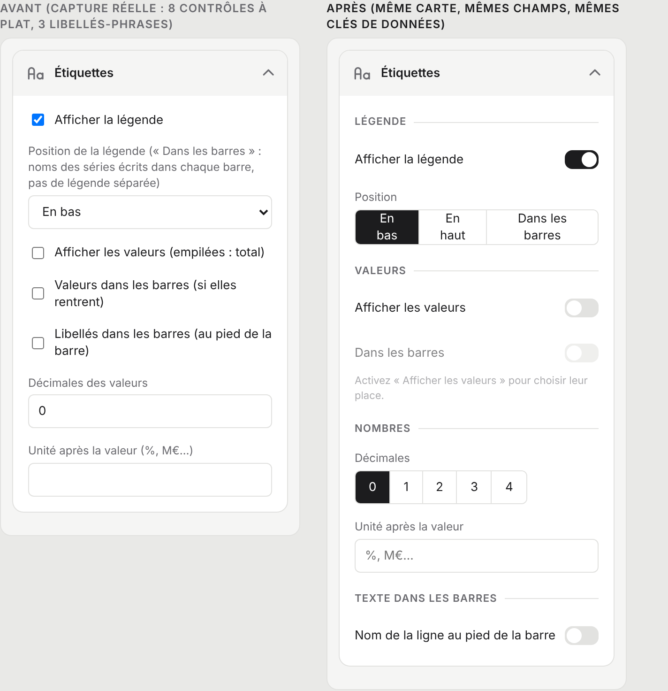
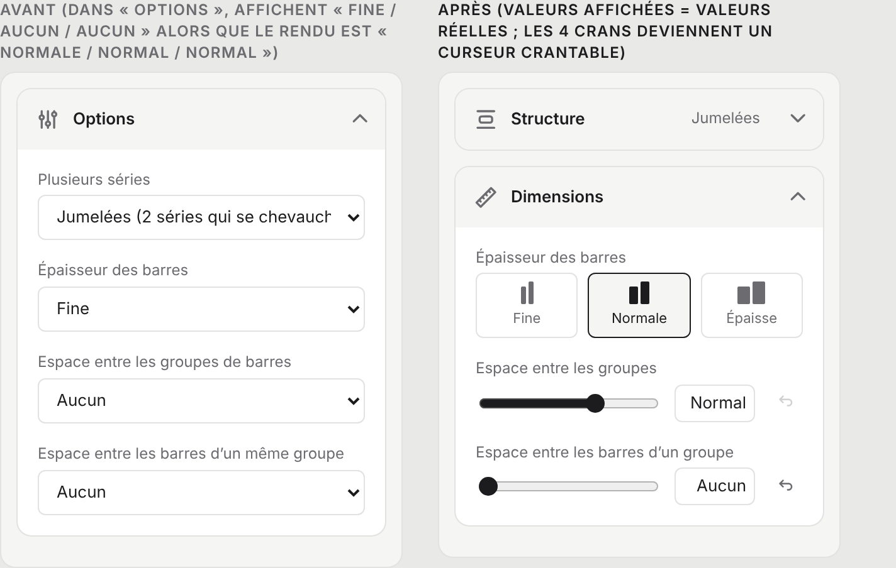
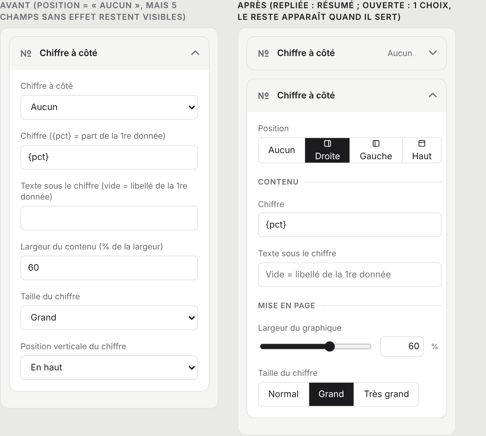

# Audit UX — sidebar de l'éditeur de dataviz

Date : 2026-11-09 · Périmètre : onglet **Visualisation** de l'éditeur de dataviz (`factsheet/src/vizeditor.js`, panneau de 320 px à droite).
**Rien n'est implémenté** : aucun fichier de `factsheet/src/` n'a été modifié, la version n'a pas changé. Ce document complète `docs/audit-ux-sidebars.md` (5 nov., qui traitait la structure générale de l'éditeur et du panneau des propriétés) : ici on descend dans le détail des cartes et des champs.

**Comment lire ce document.** Les « cartes » sont les blocs repliables du panneau (Type, Titre et source, Étiquettes…). Un « champ » est un réglage (une case, une liste, un nombre). Chaque constat renvoie à du code (`fichier:ligne`) ou à une capture (`docs/captures/sidebar-dataviz-*.png`). Les mesures ont été faites dans l'interface réelle (Chromium, 17 types ouverts, cartes dépliées via la recherche).

**Méthode.** Inventaire des 140 champs des 17 types extrait du code exécuté (pas de mémoire) puis recoupé à la lecture ; captures de 6 types ; mesures de tailles et de contrastes ; test clavier (Tab, Échap) ; grilles d'analyse des compétences `design-critique`, `design-system`, `accessibility-review` (WCAG 2.1 AA).

---

## 1. Synthèse

**Les 5 constats les plus importants**

1. **Le panneau ment sur 7 réglages** : pour les barres (épaisseur, deux espaces), les barres horizontales (idem) et l'anneau (interlignage), la liste affiche « Fine / Aucun / Aucun » alors que le graphique est dessiné en « Normale / Normal / Normal » (C1).
2. **Échap, même depuis le champ de recherche, ferme l'éditeur et annule tout**, sans confirmation (C2).
3. **« Options » est un fourre-tout, et c'est la carte ouverte au départ** : de 1 à 8 réglages sans rapport (forme, angles, trait de liaison, espaces…) ; 66 champs sur 140 changeraient de carte dans le squelette proposé (C3, C4).
4. **Un même réglage change de carte, d'ordre et de libellé selon le type** (légende, valeurs, décimales, unité, espace) et **aucun champ ne dépend d'un autre** : « Position de la légende » reste actif légende éteinte (C5, C6).
5. **Les contrôles ne sont pas ceux que les règles du projet demandent** : 24 listes sur 38 n'ont que 2 ou 3 valeurs (règle : `pair`), cases natives, 13 champs « décimales 0–4 » saisis au clavier, aucun curseur ni réinitialisation (C8–C10) ; et côté clavier/lecteur d'écran, le focus s'échappe de l'éditeur et les boutons de cartes s'annoncent tous « Déplier / Replier » sans nom (C11, C12).

**Les 5 décisions à prendre** (détail et autres questions en §7)

- **D1** Adopter le **squelette de 10 cartes** (§3.1), dont la disparition du mot « Options ».
- **D2** Aligner l'**affichage** sur le rendu (valeur par défaut lue par le panneau) plutôt que de changer le rendu : les documents existants ne bougent pas (§6).
- **D3** Interrupteurs, curseurs et sélection **en neutre** (encre), pas en rouge d'accent (`--accent` = `#C0392B`, appelé `--ui-blue` dans `app.css`).
- **D4** Sous-sections **sans repli** (titre + filet) dans les cartes de plus de 6 champs (§3.4).
- **D5** Lancer d'abord le **lot 1** (corrections de vérité, risque quasi nul), puis les lots 2 à 4 dans l'ordre (§6).

---

## 2. Constats

Légende : 🔴 **bloquant** (fait perdre du travail ou affiche du faux) · 🟠 **gênant** (ralentit ou égare) · 🟢 **confort**.

### 🔴 Bloquants

**C1 — Des listes affichent une valeur qui n'est pas celle du rendu.**
Le panneau lit la valeur du document ; si elle est absente, il affiche **la première option** (`editor.js:904` : `getP(obj, f.k) ?? Object.keys(opts)[0]`), alors que le dessin applique un autre repli. Cas vérifiés (le champ n'est pas dans `defaults()`) :

| Type | Champ | Affiché | Dessiné |
|---|---|---|---|
| Barres | `barSize`, `groupSpace`, `serSpace` | Fine / Aucun / Aucun | Normale / Normal / Normal (`viz/bars.js:136-137`, `?? 1`) |
| Barres horizontales | `barSize`, `rowSpace`, `serSpace` | idem | idem (`viz/hbars.js:103,107`) |
| Anneau | `leading` | Serré | Normal (`viz/donut.js:214`, `LEAD.normal`) |

Preuve : capture `sidebar-dataviz-editor_bars_default.png` (barres de taille normale, liste « Fine »). Conséquence : le premier geste sur la liste change le dessin même si on « choisit » la valeur déjà affichée. Le mécanisme de correction existe déjà et n'est pas branché : `linkColor` déclare `def: 'blue'` (`donut.js:95`) mais aucun code ne lit `def`.

**C2 — Échap annule tout l'éditeur, sans confirmation.**
`vizeditor.js:766-770` : toute touche Échap appelle `close(false)`, qui rétablit l'instantané d'ouverture. Testé : on ouvre l'éditeur, on change le type, on tape dans la recherche, **Échap → l'éditeur se ferme** (le même Échap sert à vider un champ de recherche ou à fermer une liste riche). Un utilisateur au clavier perd son travail en voulant seulement fermer une liste. À corriger : Échap ferme d'abord ce qui est ouvert (liste, recherche), et n'annule l'éditeur qu'à vide, avec confirmation s'il y a des modifications (`confirmModal` de `dialogs.js`).

### 🟠 Gênants

**C3 — « Options » est un fourre-tout.** Règle par défaut : tout champ non reconnu va dans `style` (`vizeditor.js:34-35`), c'est-à-dire « Options ». Résultat : 8 champs pour l'anneau (forme, alignement vertical, interlignage, longueur et couleur du trait de liaison, orientation, deux angles ; `sidebar-dataviz-form_donut.png`), 6 pour la liste à icônes, 5 pour les barres horizontales et le waffle. Les sujets mélangés sont des **structures** (forme, orientation, alignement), des **dimensions** (épaisseur, espaces, rayon), des **étiquettes** (`showLabels`, `showTotal`, `showDates`) et des **couleurs** (`color`, `linkColor`).

**C4 — La carte ouverte au départ est « Options ».** `vizeditor.js:26` et `:473` : `acc.first` prend la première de `dv-style`, `dv-labels`, `dv-colors`. Constaté sur les courbes : la carte ouverte ne contient qu'une case (« Axe vertical démarrant à zéro »). Le choix du premier geste est donc dicté par un reste de tri, pas par l'usage.

**C5 — Mêmes réglages, rangements et libellés différents d'un type à l'autre.**
- **Ordre dans la carte** = ordre de déclaration dans le fichier du type : barres `legend, legendPos, showValues, …, valuesIn, labelIn` (`bars.js:67-91`) ; barres horizontales `labelIn, valuesIn, segments, legend, legendPos, showValues` (`hbars.js:51-61`).
- **Libellés** : `decimals` a 4 formulations (valeurs / total / axes / pourcentages), `legend` 3 (« Afficher la légende », « (niveau 1) », « (groupes) »), `showLabels` 3 (« les noms », « le nom des points », « les noms sur les arcs »).
- **« Espace »** se dit `pad`, `gap`, `nodePad`, `rowGap`, `rowSpace`, `groupSpace`, `serSpace` ; tantôt une liste à 4 crans, tantôt des pixels.
- **Même sujet, cartes différentes** : `showLabels`, `groupLabels`, `showTotal`, `showPercent`, `showDates` sont dans « Options » alors que `showValues` est dans « Étiquettes » ; `xTitle`/`yTitle` forcés en « Étiquettes » par `g:`.
- **Trait de liaison** : `linkExtra` + `linkColor` (anneau, dans Options), `bracketLink` (liste à icônes, dans Options), `callout.*` (barres, carte Évolution) : trois habillages pour une même idée d'accolade.
- **Absences** : l'anneau n'a ni `legend` ni `suffix` ; la frise et la liste à icônes n'ont pas de carte Étiquettes ; waffle, enquête n'ont pas d'unité.

**C6 — Aucune dépendance entre champs.** `buildFields` n'a pas de notion de condition (aucun `when`/`show` dans `editor.js` ni dans les 17 types). Réglages restés actifs sans effet :
`legendPos` (légende éteinte) ; `valuesIn` (valeurs éteintes — `hbars.js:52` l'écrit même dans son libellé) ; `largestAngle` et `startAngle` selon `orient` (`donut.js:97-107`) ; `callout.value`/`callout.text` sans `callout.on` ; `bracketGap`/`bracketLink` sans `bracket` ; et surtout la carte **Chiffre à côté** : 5 champs sur 6 sans effet tant que « Aucun » (`index.js:141-148`, `composeSide` : `share` et `align` ne servent que pour droite/gauche, `index.js:177`).

**C7 — La carte « Chiffre à côté » est en 3ᵉ position (≈ 740 px ouverte) alors que sa valeur par défaut est « Aucun »**, et son premier champ s'appelle comme elle (`vizeditor.js:489-493` + `index.js:142`) : « Chiffre à côté / Chiffre à côté ».

**C8 — Les types de contrôle contredisent les règles du projet.** Répartition réelle des 140 champs : 40 cases (`bool`), 38 listes, 35 nombres, 16 textes, 5 couleurs. Sur les 38 listes : **24 ont 2 ou 3 valeurs** (règle : `pair`), 14 en ont 4. Les 13 « décimales » (0–4) et les rayons, espaces, angles sont des champs numériques bruts (`editor.js:773-792`), sans curseur, sans unité visible, sans valeur par défaut. Les `bool` sont des cases à cocher natives de 13 × 13 px, à la couleur bleue du navigateur (hors palette) ; l'interrupteur `pp-switch` existe pourtant (`props/kit.js:204-213`).

**C9 — Libellés en phrases.** 10 libellés dépassent 45 caractères, jusqu'à 109 (`Position de la légende (« Dans les barres » : noms des séries écrits dans chaque barre, sans légende séparée)`, `hbars.js:56`). Moyenne 27, soit 2 lignes dans un panneau de 256 px utiles. Les consignes sont dans le libellé au lieu de l'aide `?` (qui n'a d'entrée que pour ~30 libellés : `help.js`).

**C10 — Pas de réinitialisation, pas de valeur par défaut visible, pas d'unité.** On ne voit jamais si une valeur a été modifiée, ni laquelle était l'origine. L'historique propre de l'éditeur (`hist`, `vizeditor.js:248-286`) est la seule issue.

**C11 — Clavier et focus (WCAG 2.1.1, 2.4.3).**
- L'éditeur n'est ni `role="dialog"` ni piège à focus : depuis la recherche, 8 Tab traversent les cartes puis **le focus sort vers l'en-tête de l'app** (`BODY.ve-open` → « GSC tools », « File »…, test réel).
- L'en-tête d'une carte est un `div` cliquable (`cards.js:67-74`) : seul le chevron est atteignable au clavier, et son nom est « Expand » / « Collapse » **sans nom de carte** (5 boutons identiques d'affilée) ; pas de `aria-controls`.
- Onglets Données / Visualisation : `role="tablist"` sur le conteneur mais **aucun `role="tab"`** sur les boutons, `aria-selected` posé sur des boutons simples (`vizeditor.js:150-176`).
- **Cliquer sur le texte d'un libellé ne met pas le focus dans le champ** (testé : le focus reste sur `body`). Cause : `helpBtn` est placé *dans* le `<label>` avant le champ (`editor.js:779, 905`), un bouton étant « labelisable » ; c'est précisément la règle « jamais un bouton dans un `<label>` » du projet.

**C12 — Contrastes et focus visible (WCAG 1.4.11, 2.4.7).** Calculés sur les valeurs de `tokens.css` / `app.css` :

| Élément | Couleurs | Rapport | Exigé | |
|---|---|---|---|---|
| Libellés et aides (`--mute` sur blanc / sur fond de carte) | `#6b6b70` | 5,3 / 4,9 | 4,5 | ✅ |
| Rouge d'accent sur blanc | `#C0392B` | 5,4 | 4,5 | ✅ |
| **Anneau de focus** des champs (`app.css:31`, `#9bbbe6` codé en dur) | | **1,97** | 3 | ❌ |
| **Interrupteur éteint** (`app.css:270`, `#c9c9cc`, codé en dur) | | **1,65** | 3 | ❌ |
| **Bordure des champs** (`--line`) | `#e2e2e0` | **1,3** | 3 | ❌ (si la bordure est le seul repère du champ) |

L'anneau de focus et le gris de l'interrupteur sont aussi des valeurs de couleur en dur, contre la règle de `CLAUDE.md`.

**C13 — Le rouge marque des états « sélectionné », contre la règle « Rouge = action ».** `--ui-blue` est un alias historique de `--accent` (rouge, `app.css:1`). La liste des types colore en rouge le type choisi (`app.css:416`, capture `sidebar-dataviz-typelist.png`) ; `.seg button.on` (`app.css:213`) et `.pp-switch.on` (`app.css:272`) aussi. La doc (`architecture.md`) demande le neutre pour « onglets, espacement, cartes de type ». Ces deux composants sont ceux qu'on voudrait réutiliser : à neutraliser **avant** de les généraliser.

**C14 — Le résumé « Renseigné / Aucun » de « Titre et source » n'apparaît jamais.** `card()` est déclarée à 5 paramètres (`vizeditor.js:315`) ; l'appel passe `null` en 5ᵉ position et le résumé en 6ᵉ (`:479-486`) : il est ignoré. Mesuré : zéro `.pp-sum` dans le panneau. Aucune carte du panneau ne résume donc sa valeur repliée, alors que le panneau des propriétés le fait (`props/kit.js:216-221`).

**C15 — Recherche sans état vide.** « zzzz » masque les 9 cartes et laisse un panneau vide, sans message (`cards.js:23-50`). Autre limite : elle filtre sur le texte du DOM, donc cherche aussi dans les options des listes (« Normal » fait apparaître presque tout).

### 🟢 Confort

**C16 — L'aide de la barre d'aperçu reste en français en interface anglaise** (`vizeditor.js:205-209`, `hint.textContent` sans `t()`), visible sur chaque capture .

**C17 — Le champ `ratio` (« Format du graphique ») est orphelin ou doublonné.** Groupe `ratio` : aucune carte ne l'affiche dans l'éditeur ; il vit dans la carte « Hauteur » des propriétés (`vizheight.js:52`). Seuls les pictogrammes simples V/H le forcent dans une carte « Dimensions » (`g:'format'`, `picto.js:284-288`), alors qu'ils déclarent `heights: ['ratio', …]` (`picto.js:266`) : **doublon** avec la carte Hauteur, que l'architecture a justement retirée de l'éditeur.

**C18 — Densité et hiérarchie.** Les valeurs de l'échelle `--fs-*` sont respectées (libellés 12 px, titres de carte 13 px gras, aides 12 px) ; en revanche **le titre de carte (13 px) et un libellé de champ (12 px) ne se distinguent que par le gras** et l'arrière-plan gris de l'en-tête. Dans une carte longue (Étiquettes des barres : 7 champs), rien ne sépare « légende », « valeurs » et « nombres » : c'est ce que les sous-sections corrigent (§3.4).

**Ce qui fonctionne bien (à conserver).**
- L'**accordéon** et l'**état gardé** d'une ouverture à l'autre (`acc` au niveau du module) : une seule carte ouverte = un panneau qui tient dans l'écran (≈ 700 px repliées contre 2 375 px tout ouvert).
- Le **type** dans sa propre carte repliée, avec l'icône et le nom courant, et la **liste groupée par famille** (`typelist.png`) : lisible, icônes au trait.
- La **recherche** transversale et le **filtrage par carte**.
- L'**aperçu en direct** : chaque changement redessine (`changed()` → `draw()`), l'historique de l'éditeur regroupe la frappe sur 1 s.
- Les **couleurs en pastilles** (`colorSelect`, `iconSelect`) et les **boutons « ? »**.
- La séparation **Données / Visualisation** et le **panneau à largeur fixe de 320 px**.

---

## 3. Squelette de cartes recommandé

### 3.1 Un seul squelette, pour tous les types

Principe : **mêmes cartes, même ordre, pour les 17 types**. Une carte sans contenu pour un type est **masquée, jamais déplacée** (c'est déjà le cas pour Dimensions ou Évolution : `vizeditor.js:462-472`). L'ordre suit le raisonnement d'un concepteur : *quoi* → *comment c'est construit* → *quelle taille* → *quels textes* → *quelles couleurs* → *annotations* → *technique*.

| # | Carte (EN / FR) | Rôle | Un champ va ici si… | Aujourd'hui |
|---|---|---|---|---|
| 0 | Recherche | Trouver un réglage | — | `searchBox` |
| 1 | **Type** / Type | Choisir la forme de dataviz | c'est le choix du type | `dv-type` ✔ |
| 2 | **Title and source** / Titre et source | Textes qui entourent le graphique | c'est un texte *du document* hors données (titre, source) | `dv-head` ✔ |
| 3 | **Pictogram** / Pictogramme | Choix de l'icône (4 types de pictogrammes) | il définit *quelle icône* | `dv-picto` ✔ (reste) |
| 4 | **Structure** / Structure | Comment le graphique est construit | changer ce réglage **change la construction ou la lecture** du graphique, sans en changer l'échelle : mode de séries, orientation, forme, alignement, grille, axe à zéro, angle, échelle de valeur d'un pictogramme | dans « Options » |
| 5 | **Dimensions** / Dimensions | Tailles et espaces | c'est **une taille ou un espace** (épaisseur, écart, rayon, trou, largeur de nœud, échelle d'icône) | dans « Options » (+ pictos V/H) |
| 6 | **Labels** / Étiquettes | Tous les textes *dans* ou *autour* des données | c'est **un texte ou un nombre affiché** : légende, noms, valeurs, décimales, unité, titres d'axes, texte du centre | « Étiquettes » + une partie d'« Options » |
| 7 | **Colours** / Couleurs | Toutes les couleurs | c'est **une couleur** du graphique (palette du document, couleur de picto) | « Couleurs » (un seul bouton) |
| 8 | **Bracket and link** / Accolade et liaison | Annotations qui relient à la colonne voisine | c'est **l'accolade « évolution »**, l'accolade de liste ou le trait de liaison de l'anneau | « Évolution » + « Options » |
| 9 | **Figure beside** / Chiffre à côté | Gros chiffre accolé au graphique | c'est le chiffre à côté (champ commun à tous les types) | `dv-side` (3ᵉ aujourd'hui) |
| 10 | **Advanced** / Avancé | Outils techniques | c'est de l'outillage (export de débogage, copier/coller de réglages) | `dv-debug` ✔ |

« **Options** » disparaît : une carte nommée « Options » est par définition le reste. Le `ratio` reste dans les propriétés › Hauteur (C17).

**Pourquoi 10 et pas plus ?** Chaque type affiche 5 cartes toujours présentes (Type, Titre et source, Couleurs, Chiffre à côté, Avancé) et **2 à 4 cartes de contenu** (mesuré sur les 17 types : ex. barres = Structure, Dimensions, Étiquettes, Accolade ; courbes = Structure, Étiquettes ; treemap = Dimensions, Étiquettes). Aujourd'hui, 7 à 9 cartes dont une surchargée ; demain autant, mais la plus longue (Étiquettes) compte au plus 7 champs, contre 8 pour « Options » de l'anneau.

### 3.2 Règle de décision écrite (à ajouter à `architecture.md`)

> **Où range-t-on un nouveau champ de dataviz ?** Poser les questions dans l'ordre ; la première réponse « oui » donne la carte.
> 1. C'est une **donnée** (tableau, liste d'éléments) ? → onglet **Données**.
> 2. C'est une **couleur** ? → **Couleurs**.
> 3. C'est un **texte ou un nombre affiché** (légende, nom, valeur, décimale, unité, titre d'axe, texte central) ? → **Étiquettes**.
> 4. C'est une **taille, un écart ou un rayon** (px, ou cran d'espace) ? → **Dimensions**.
> 5. C'est une **accolade ou un trait de liaison** vers la colonne voisine ? → **Accolade et liaison**.
> 6. Sinon, ça change la **construction** du graphique ? → **Structure**.
> Un champ **sans** `g:` explicite est refusé par un test (plus de rangement par défaut). Le libellé est court (≤ 40 caractères) ; la consigne va dans `help.js`.
> Les champs qui se retrouvent dans plusieurs types (`legend`, `legendPos`, `showValues`, `decimals`, `suffix`, `showLabels`) gardent **la même clé, le même libellé et le même ordre** ; l'ordre dans la carte est fixé par une liste unique (`FIELD_ORDER`), pas par l'ordre de déclaration du fichier du type.

### 3.3 Statut des cartes particulières

| Carte | Verdict | Recommandation |
|---|---|---|
| **Type** | ✅ bonne (repliée, résumé = type courant) | Garder. Passer l'état sélectionné de la liste en **neutre** (C13). Le sélecteur est le seul vrai « contrôle principal » : lignes de 44 px, il est à ≈ 36 px aujourd'hui. |
| **Titre et source** | ✅ garder en 2ᵉ, **corriger le résumé** (C14) | Résumé replié : le titre lui-même, tronqué (« Chiffres clés 2025 »), plutôt que « Renseigné ». |
| **Chiffre à côté** | ⚠️ trop haut, tout visible | Descendre en 9ᵉ ; **un seul choix** quand « Aucun » (§5, maquette 3) ; résumé « Aucun » / « À droite · 60 % ». |
| **Évolution** | ⚠️ ne sert qu'aux barres (`callout.*`), nom trop précis | Fusionner en « **Accolade et liaison** » avec l'accolade de la liste à icônes et le trait de liaison de l'anneau. |
| **Pictogramme** | ✅ cohérent | Garder, en 3ᵉ. Sa couleur (`color`) va dans Couleurs. |
| **Couleurs** | ⚠️ un seul bouton « Couleurs du document » | Y rassembler les couleurs propres au graphique (`color` des pictos) ; pastilles des séries en lecture seule (clic = éditer, déjà possible sur l'aperçu). Résumé : « 2 séries ». |
| **Avancé** | ✅ | Garder en dernier, y mettre « Copier / coller les réglages » (§5.3). |

### 3.4 Sous-sections dans les cartes denses

**Seuil.** Une carte de **6 champs ou plus**, ou qui mêle **3 sujets distincts**, reçoit des sous-sections ; en dessous, pas de titres (ce serait du bruit). Après le nouveau squelette (comptes mesurés), seules sont concernées **Étiquettes** (7 champs pour barres, barres horizontales, nuage de points, treemap ; 6 pour sunburst et bulles) et **Structure de l'anneau** (5 champs + 2 actions). Toutes les autres cartes ont 1 à 5 champs : pas de titres.

**Rendu.** Un **titre de sous-section** : 11 px (`--fs-xs`), capitales, `--mute`, suivi d'un **filet** 1 px `--line` sur le reste de la ligne (classe `.pp-sub`, maquette). Pas de repli (un deuxième niveau d'accordéon alourdit le clavier et masque des réglages) ; l'espacement entre groupes est celui du `gap` de `.pp-body` (16 px) et le titre prend 4 px au-dessus. Sémantique : `role="group"` + `aria-labelledby` sur le conteneur des champs. **Un titre n'est jamais focalisable.** Déclaration dans le champ : `s: 'legend'` (clé de sous-section, traduite), réglée par la même table que `g:`.

**Sous-sections par carte (vocabulaire figé)**

| Carte | Sous-sections possibles |
|---|---|
| Étiquettes | **Légende** · **Valeurs** · **Nombres** · **Noms et textes** · **Axes** · **Texte dans les barres** |
| Structure | **Séries** · **Orientation** · **Axes** (zéro) · **Échelle** |
| Dimensions | **Barres** · **Espaces** (uniquement si ≥ 5 champs) |
| Accolade et liaison | **Accolade** · **Trait de liaison** |

**Application à trois types aux profils différents**

*① Barres verticales (`bars`) — 17 champs, 7 cartes, beaucoup de bascules.*

| Carte | Sous-section | Champs |
|---|---|---|
| Structure | — | `style` (Séries : jumelées / côte à côte / empilées, **`pair` à 3 valeurs courtes**) |
| Dimensions | — | `barSize` (vignettes), `groupSpace` et `serSpace` (curseurs à 4 crans) |
| Étiquettes | Légende | `legend`, `legendPos` (segmenté 3 valeurs, grisé si légende éteinte) |
| | Valeurs | `showValues`, `valuesIn` (grisé si valeurs éteintes) |
| | Nombres | `decimals` (segmenté 0–4), `suffix` |
| | Texte dans les barres | `labelIn` |
| Accolade et liaison | — | `callout.on` (interrupteur), puis `callout.value`, `callout.text` visibles seulement si activé |

*② Anneau (`donut`) — 12 champs, 8 dans « Options ».*

| Carte | Sous-section | Champs |
|---|---|---|
| Structure | Forme | `style` (anneau / camembert : `pair`) |
| | Orientation | `orient` (3 valeurs : `richSelect` avec vignette d'angle), puis `largestAngle` (curseur 0–359, visible pour « Plus grand segment ») ou `startAngle` (visible pour « Manuel ») |
| | Position | `ringAlign` (`pair` icônes haut/centre/bas) + actions « Positions auto » / « Plus grand en premier » |
| Étiquettes | Texte central | `totalTpl`, `decimals` |
| | Libellés | `layout` (auto / autour / légende), `leading` (segmenté, **affiche Normal**, C1) |
| Accolade et liaison | Trait de liaison | `linkExtra` (curseur 0–120 px), `linkColor` |

*③ Treemap (`treemap`) — type hiérarchique, partagé avec sunburst et bulles.*

| Carte | Sous-section | Champs |
|---|---|---|
| Dimensions | — | `pad` (curseur 0–12 px) |
| Étiquettes | Noms | `showLabels`, `groupLabels` |
| | Valeurs | `showValues` |
| | Légende | `legend` (niveau 1), `legendPos` (grisé si éteinte) |
| | Nombres | `decimals`, `suffix` |

Ce découpage est **identique** pour sunburst (`showLabels`, `showTotal` vers Étiquettes ; `hole` vers Dimensions) et bulles (`pad` vers Dimensions ; `parents` vers Structure), ce qui est le but.

### 3.5 Accordéon, ouverture par défaut, recherche, résumés

| Sujet | Constat | Recommandation |
|---|---|---|
| **Accordéon** | Marche : une carte ouverte, état gardé entre les ouvertures (`acc`, module). Gêne : l'ordre changeant selon le type fait que « la carte que je viens d'utiliser » n'est pas au même endroit. | Garder. Avec le squelette fixe, la mémoire musculaire suffit. Option confort (à valider) : **Maj + clic** ouvre plusieurs cartes. |
| **Carte ouverte par défaut** | `Options` (reste de tri, C4). | Ouvrir **Structure** si elle a du contenu, sinon **Étiquettes** ; jamais Type ni Titre. Mémoriser le dernier choix **par type**. |
| **Recherche** | Utile ; pas d'état vide (C15) ; filtre sur du texte brut. | Ajouter « Aucun réglage ne correspond à « zzzz » » avec un bouton « Effacer ». Cibler libellé + aide (`HELP`), pas le texte des options. Échap vide d'abord la recherche (C2). |
| **Résumés repliés** | Aucun affiché (C14). | Brancher `sum` partout : Titre (début du texte), Type (déjà), Structure (« Jumelées »), Dimensions (« Normale · Normal »), Étiquettes (« Légende en bas · valeurs »), Couleurs (« 2 séries »), Accolade (« +64 % » ou « Aucune »), Chiffre à côté (« Aucun » / « Droite · 60 % »). Une ligne, tronquée par `text-overflow` (déjà prévu : `.pp-sum`). |

---

## 4. Catalogue de contrôles

Composants **existants** à réutiliser : `pair`/`seg seg-text` et `segmented` (`props/kit.js:64-110`), `switchBtn`/`switchRow` (`:204-213`), `rangeRow` (curseur + valeur, `:233-250`, aujourd'hui **valeur non éditable**), `richSelect`/`colorSelect`/`iconSelect`. Ils vivent dans `createKit(root, ctx, doc, kind)` (propriétés) : le plan prévoit de les **extraire dans un module commun** (`src/controls.js`) utilisable par `buildFields` (qui sert aussi le Labo : `labo.js:219-225`).
Nouveaux types de champ de `buildFields` : `t: 'switch'`, `t: 'seg'`, `t: 'range'`, `t: 'thumbs'` ; tous déclarent `def` (valeur par défaut, lue par le panneau — corrige C1).

### 4.1 Tableau champ → contrôle

| Champ (types) | Contrôle actuel | Contrôle recommandé | Raison |
|---|---|---|---|
| `legend`, `showValues`, `showLabels`, `groupLabels`, `showTotal`, `showPercent`, `showDates`, `zero*`, `callout.on`, `bracket`, `circle`, `parents`, `alternate`, `labelIn`, `valuesIn` (40 `bool`) | case native 13 px | **Interrupteur** (`t:'switch'`) | Afficher/masquer = interrupteur ; ligne de 32 px ; couleur neutre ; garde `aria-checked` |
| `legendPos` (barres : 3, autres : 2) | liste | **Segmenté** (`pair`) | 2–3 valeurs courtes (règle du projet) ; grisé si légende éteinte |
| `style` des barres (3), barres horizontales (2), anneau (2), `orientation`, `shape`, `tail` (3), `align` sankey (4) | liste | `pair` (≤ 3) ; `richSelect` avec vignette pour `align`, `tail`, `orient` | Règle « 2–3 valeurs = pair, choix de type = richSelect » |
| `barSize` (3 ou 4 valeurs) | liste | **Vignettes** (`thumbs`) : 3 barres de largeur croissante | Le choix se *voit* ; 3–4 cases de 44 px de haut |
| `groupSpace`, `serSpace`, `rowSpace`, `rowGap`, `bracketGap` (4 crans) | liste | **Curseur à crans** + valeur éditable + ↺ | Valeur ordonnée ; la valeur affichée = valeur réelle (C1) ; clavier ↑↓ |
| `decimals` (13 types, 0–4) | nombre | **Segmenté 0·1·2·3·4** | 5 valeurs, 1 clic, aucune saisie ; remplace le champ numérique |
| `suffix` | texte | Texte + **suggestions** `%`, `M€`, `Md€` (pastilles) | Évite de taper des symboles ; reste libre |
| `pad`, `gap`, `nodeW`, `nodePad`, `maxR`, `hole`, `linkExtra`, `bracketLink` | nombre brut (px) | **Curseur** (`range`) + champ éditable + unité (« px ») | Valeur bornée par `min`/`max` déjà déclarés ; le glisser *prévisualise* en direct |
| `largestAngle`, `startAngle` | nombre 0–359 | **Curseur** 0–359 + champ éditable + unité « ° » | Aucun nouveau composant (pas de cadran) ; visible seulement selon `orient` |
| `cols`, `gridRows` (waffle) | nombre | **Stepper** (− / + avec valeur) | Valeurs entières petites, on compte les cases ; pas de curseur (l'effet n'est pas continu) |
| `perDot`, `perRow`, `total`, `perIcon` | nombre libre (`step: any`) | Nombre libre + **« Auto »** (case à cocher pour 0) | 0 = automatique est une valeur magique ; l'explicite évite les erreurs |
| `ringAlign`, valign du chiffre | liste | **Segmenté à icônes** (haut / centre / bas) | 3 valeurs spatiales : `segmented` existant (`kit.js:86-110`) |
| `scale` (icônes, chiffre), `leading` | liste | **Segmenté** (« Normal · Grand · Très grand ») | 3 valeurs ordonnées |
| `color`, `linkColor` | `colorSelect` | inchangé | Déjà conforme |
| `layout` (anneau), `orient` | liste | `richSelect` avec vignette | Choix de nature visuelle |
| `totalTpl` | `ctext` (zone + 3 boutons H1/H2/Aa) | inchangé | Hors périmètre ; la consigne longue va dans l'aide |

**Pas retenus** (et pourquoi) : un **stepper** pour les espaces (le curseur à crans est plus rapide) ; un **segmenté** pour `groupSpace` (4 valeurs de texte longues en 256 px) ; une **bascule triple** ; un **sélecteur circulaire** d'angle (nouveau composant, gain faible).

### 4.2 Comportement détaillé des contrôles proposés

| Contrôle | Composant | Rendu | Clavier | Historique |
|---|---|---|---|---|
| **Interrupteur** | existant `switchBtn` (`kit.js:204`), neutralisé | 36 × 20 px, encre quand allumé, ligne de 32 px, tout le libellé cliquable | Tab ; **Espace/Entrée** bascule ; `role="switch"`, `aria-checked`, libellé = texte de la ligne | `ctx.changed()` ; pas de `restructure` (un parent masque ses enfants **sur place**, §4.3) |
| **Segmenté** | existant `pair`/`segmented` ; ajouter `role="radiogroup"` | boutons de 34 px (déjà), sélection **encre** | Un seul Tab dans le groupe ; **← →** déplacent *et* choisissent ; Home/Fin | `changed()` (valeur immédiate, pas de rebuild) |
| **Vignettes** | nouveau `thumbs`, dérivé du segmenté | 3 ou 4 cases de 44 px de haut : mini-dessin + libellé court ; bordure encre si choisi | comme segmenté (`radiogroup`) | `changed()` |
| **Curseur à crans** | `rangeRow` étendu (`kit.js:233`) : `<input type=range>` + champ numérique éditable + unité + ↺ | piste `accent-color: var(--ink)`, valeur en `font: var(--font-mono)` 11 px | flèches ±1 cran, PgUp/PgDn ±10 %, **Entrée** valide le champ, **↑↓** dans le champ incrémentent | `changed()` à chaque `input` ; la frappe continue est regroupée par `rec(true)` (1 s). **Attention** : `rec(true)` fusionne deux champs différents modifiés en moins d'1 s ; pour les contrôles discrets prévoir un pas distinct (`fctx.commit()` = `rec(false)`) |
| **Stepper** | nouveau, deux boutons 32 px autour d'un champ | `−  12  +` | ↑↓ dans le champ ; maintenir = répétition | `changed()` |
| **Réinitialiser ↺** | nouveau bouton 28 px au bout de la ligne (et un « Rétablir la carte » dans l'en-tête de carte quand elle a des valeurs modifiées) | grisé quand la valeur = `def` ; `aria-label` « Rétablir « Normal » » | Tab, Entrée | un pas d'historique (`restructure()`) |
| **Champ grisé + phrase** | `when` évalué sur place | `aria-disabled`, opacité .55, phrase 11 px sous le champ | un champ grisé reste **focalisable en lecture** (`aria-disabled`, pas `disabled`) pour que le lecteur d'écran lise la raison | aucun (pas une modification) |
| **Carte** (tête) | réécrire l'en-tête de `cardEl` en vrai `<button aria-expanded aria-controls>` couvrant la ligne, « ? » **à côté**, pas dedans | tête de 48 px inchangée | Entrée/Espace ; **Tab** : tête → premier champ → tête suivante ; ↑↓ entre têtes | aucun |

### 4.3 Dépendances entre champs

- **Syntaxe** dans la déclaration du champ : `when: (o) => !!o.legend` et `why: 'Activez « Afficher la légende »…'` (la phrase passe par `t()`).
- **Règle d'affichage** : *masquer* quand le champ n'a de sens que pour **un autre mode** (`largestAngle` quand l'orientation n'est pas « plus grand segment », champs du chiffre à côté quand « Aucun ») ; *griser avec une phrase* quand le champ **existe toujours** mais n'a pas d'effet **maintenant** (`legendPos` légende éteinte, `valuesIn` valeurs éteintes, `callout.value` accolade éteinte). Dans le premier cas, le panneau ne doit pas « sauter » sous le curseur : on change l'état **sur place**, sans `buildForm()` (qui reconstruit le panneau et fait perdre le focus clavier, `vizeditor.js:404-406`).
- **Ordre** : un enfant suit toujours immédiatement son parent, en retrait de 12 px (`padding-left`).

### 4.4 Aide à la décision

| Idée | Verdict | Notes |
|---|---|---|
| **Aperçu en direct** | ✅ déjà en place | `changed()` → `draw()` ; ne rien ajouter. |
| **Survol qui prévisualise** | ❌ non retenu | Impossible sur une `<select>` native ; sur segmenté/vignettes, valeur faible (un clic suffit, annulable par Cmd/Ctrl + Z) pour un risque de rendu fantôme dans l'historique. |
| **Réinitialisation par champ et par carte** | ✅ lot 4 | Demande `def` partout (corrige aussi C1). |
| **Valeurs par défaut visibles** | ✅ | Repère « valeur d'origine » (petit trait sur le curseur ; point sur le libellé quand modifié). |
| **Unités** | ✅ | `px`, `°`, `%`, `M€` dans le champ ou à côté (`unit:`). |
| **Copier / coller les réglages** | ◻ option (lot 6) | « Copier les réglages » / « Coller » dans Avancé : copie les **clés communes** (`legend`, `decimals`…) vers une autre dataviz, même d'un type différent ; **utile seulement si les clés sont cohérentes** (§3.2). Un pas d'historique, via `fctx.restructure()`. |

---

## 5. Maquettes avant / après

Fichier : [`audit-sidebar-dataviz-maquettes.html`](audit-sidebar-dataviz-maquettes.html) (HTML/CSS statique, variables de `css/tokens.css`, panneau de 320 px). Les captures ci-dessous en sont tirées.

### 5.1 Carte « Étiquettes » — barres (sous-sections, interrupteurs, dépendance)

Avant : 7 contrôles à plat, 3 libellés-phrases. Après : 4 sous-sections, interrupteurs neutres, position en segmenté, « Dans les barres » grisé **avec sa raison**, décimales en segmenté, libellés courts.

### 5.2 Carte « Dimensions » — barres (vignettes, curseurs à crans, valeur réelle, ↺)

Avant : 4 listes dont 3 affichent une valeur fausse (C1). Après : « Structure » (repliée, résumé « Jumelées ») séparée de « Dimensions » ; épaisseur en vignettes ; espaces en curseurs à 4 crans avec valeur écrite et ↺.

### 5.3 Carte « Chiffre à côté » — réglages masqués tant que « Aucun »

Avant : 6 champs, 5 sans effet. Après : carte repliée avec résumé ; ouverte, un seul choix tant que « Aucun » ; sous-sections « Contenu » et « Mise en page ».

### 5.4 Captures de l'existant (preuves)

| Type | Capture |
|---|---|
| Éditeur, barres, état d'ouverture | `captures/sidebar-dataviz-editor_bars_default.png` |
| Liste des types (sélection rouge) | `captures/sidebar-dataviz-typelist.png` |
| Barres, toutes cartes ouvertes | `captures/sidebar-dataviz-form_bars.png` |
| Barres horizontales | `captures/sidebar-dataviz-form_hbars.png` |
| Anneau (8 champs dans Options) | `captures/sidebar-dataviz-form_donut.png` |
| Treemap | `captures/sidebar-dataviz-form_treemap.png` |
| Pictogrammes · barres | `captures/sidebar-dataviz-form_pictobars.png` |

---

## 6. Risques, compatibilité et plan de mise en œuvre

### 6.1 Risques et compatibilité

| Sujet | Analyse |
|---|---|
| **Anciens fichiers** | **Aucune clé ne change** (règle : « ne jamais renommer une clé »). Les 66 déplacements de champ sont **tous de l'affichage** (`g:` et nouvelle table de rangement) ; le tableau de l'annexe l'indique ligne à ligne. Aucun `migrate` à écrire. |
| **C1 (valeurs affichées)** | Correction **d'affichage seulement** : la valeur par défaut est lue par le panneau (`def`), le dessin ne change pas, donc les documents existants et les pages sont identiques au pixel. À ne **pas** faire : écrire la valeur dans `defaults()` d'anciens documents (cela changerait ce qui est stocké). |
| **Pictos V/H (`ratio`, C17)** | Retrait de `g:'format'` = affichage seulement ; `ratio` reste réglable dans propriétés › Hauteur. |
| **Tests visuels de référence** | `tests/references/` ne contient que les **pages du document** ; aucun test ne capture la sidebar (grep : pas de `ve-form`/`dv-` dans les `*.spec.js`). Le panneau gardant 320 px, le zoom « Ajuster » (qui dépend de la zone d'aperçu, `vizeditor.js:179-187`) ne change pas. **Aucune capture de référence ne doit être mise à jour.** |
| **i18n** | `tests/i18n.spec.js` (`eachCard`) scanne chaque carte du panneau : tout nouveau libellé, sous-section, résumé ou phrase d'explication **doit** être dans `i18n.js` (clé sans espace aux bords, sans doublon). Les titres de cartes renommés (Structure, Accolade et liaison) aussi. Les aides `?` sont indexées par libellé français : un libellé raccourci perd son entrée de `help.js` tant qu'elle n'est pas renommée. |
| **Labo** | `labo.js:219-225` utilise `ty.fields` et `buildFields` avec **son propre regroupement** (« Options du type ») : il n'utilise pas `groupOf`, donc **les déplacements ne l'affectent pas**. Les nouveaux contrôles de `buildFields` y apparaîtront (bénéfice) ; les raccourcissements de libellés aussi (à repasser dans les variantes). |
| **Éditeur de texte riche** | `richEditor` n'est pas touché (utilisé par `softField`, `ctext`, `rich: true`). Les contrôles proposés n'y touchent pas. À surveiller : `softField` conserve ses boutons « Lien » / « Mise en forme ». |
| **Historique** | Voir §4.2 : `rec(true)` fusionne des modifications de champs différents faites en < 1 s ; ajouter un pas explicite pour les contrôles discrets. Les dépendances **sur place** n'appellent pas `restructure()`. |
| **Export PDF** | Aucun impact : le panneau est hors du document ; rien de ce qui est dessiné dans la page ne change. |
| **Règles du projet** | Interrupteurs/curseurs en neutre ; couleurs de focus et de piste par variables (`--ink`, `--line`, `--mute`), pas de valeur en dur (corrige `#9bbbe6` et `#c9c9cc`) ; icônes Tabler au trait ; aucune dépendance. Tout ce qui est proposé se fait avec les composants et variables existants. |

### 6.2 Plan par lots (indépendants, dans l'ordre conseillé)

| Lot | Contenu | Taille | Fichiers | Risques | Critère de réussite |
|---|---|---|---|---|---|
| **1 — Corriger ce qui est faux** *(premier lot : le plus gros gain, le plus petit risque)* | C1 : `def` lu par les listes, nombres et cases ; `def` ajouté aux 7 champs (barres, barres horizontales, anneau) ; C2 : Échap ne ferme plus quand une liste/recherche est ouverte, confirmation si modifié ; C14 : branchement des résumés (`sum`) ; C13 : sélection de la liste des types en neutre ; C11 : `role="dialog"`, piège à focus, `role="tab"`, nom des chevrons (« Déplier Étiquettes ») ; `helpBtn` hors du `<label>` ; C15 : message « aucun résultat » ; C16 : traduction de l'aide | **S** (0,5–1 j) | `editor.js`, `vizeditor.js`, `cards.js`, `viz/bars.js`, `viz/hbars.js`, `viz/donut.js`, `css/app.css`, `i18n.js` | Presque nul : affichage seulement. Veiller à ne **pas** écrire de valeur dans les documents | Un script parcourt les 17 types : valeur affichée de **chaque liste** = valeur utilisée par le rendu à neuf ; capture des barres : « Normale / Normal / Normal » ; Échap dans la recherche ne ferme plus ; `npm run check && npm test` verts, **aucune** référence modifiée |
| **2 — Squelette unique** | Nouvelles `g:` sur les 140 champs, nouvelle table de rangement (`groupOf` sans défaut), 10 cartes dans l'ordre fixe, `FIELD_ORDER`, « Options » supprimée, carte ouverte par défaut, « Chiffre à côté » descendue, « Évolution » → « Accolade et liaison », retrait de `g:'format'` ; test « tout champ a un `g` valide » ; règle écrite dans `architecture.md` | **M** (1–2 j) | `vizeditor.js`, `viz/*.js` (17), `i18n.js`, `help.js`, `docs/architecture.md` | Libellés renommés = clés d'`i18n` et `help.js` à suivre ; Labo (pas de `groupOf`) | Annexe du présent audit = état final (66 déplacements) ; chaque type affiche ses cartes dans l'ordre §3.1 ; `i18n.spec` vert |
| **3 — Dépendances** | `when`/`why` dans `buildFields` ; évaluation sur place ; grisés avec phrase pour `legendPos`, `valuesIn`, `callout.*`, `bracket*`, `link*` ; masquage de `largestAngle`/`startAngle`, `side.*` | **M** (1 j) | `editor.js`, `vizeditor.js`, `viz/*.js`, `css/app.css`, `i18n.js` | Rebuild du panneau (perte de focus) à éviter ; phrase à traduire | Aucun champ sans effet reste actif ; Tab ne perd pas la position quand on bascule un interrupteur parent |
| **4 — Contrôles** | Module `src/controls.js` (extraction de `switchBtn`, `segmented`, `rangeRow` de `kit.js`) ; `t:'switch'/'seg'/'range'/'thumbs'` dans `buildFields` ; ↺ par champ ; `unit` ; remplacement champ par champ selon §4.1 | **L** (2–3 j) | `props/kit.js` (extraction), `editor.js`, `viz/*.js`, `css/app.css`, `css/tokens.css` | Les propriétés réutilisent le module : **régression** des cartes de `props/` ; l'état « sélectionné » rouge de `.seg`/`.pp-switch` à neutraliser (D3) | Tous les `bool` de l'éditeur sont des interrupteurs ; les 24 listes ≤ 3 valeurs sont des `pair` ; 13 « décimales » en segmenté ; captures `props` **inchangées hors couleur** |
| **5 — Sous-sections** | `s:` dans les champs, `.pp-sub`, application à Étiquettes (barres, barres horizontales, treemap/sunburst/bulles) et Structure (anneau) | **S** (0,5 j) | `vizeditor.js`, `editor.js`, `css/app.css`, `i18n.js` | Faible | Maquette 5.1 reproduite à l'écran |
| **6 — Confort (option)** | Copier/coller de réglages ; « Rétablir la carte » ; Maj + clic pour ouvrir plusieurs cartes ; suggestions d'unité | **M** | `vizeditor.js`, `cards.js`, `controls.js` | Copier entre types : clés communes seulement | À arbitrer après les lots 1–5 |

Les lots 1 → 2 → 3/4/5 se **testent à part** et se livrent en versions successives (`version.json` par lot : correctif pour le lot 1, mineurs pour les suivants).

---

## 7. Questions ouvertes pour le propriétaire

1. **Squelette** : les noms **Structure**, **Étiquettes**, **Dimensions**, **Accolade et liaison** et l'ordre §3.1 vous conviennent-ils ? Faut-il garder « Évolution » comme nom (les barres) ou la fusion en « Accolade et liaison » ?
2. **Rouge et sélection** : les états *allumé / sélectionné* des interrupteurs, segmentés et du type courant passent en **encre** (neutre). Confirmez-vous que le rouge reste réservé aux boutons d'action (« Terminer ») ? (Les propriétés partagent ces composants : elles changeraient aussi.)
3. **Échap** : faut-il demander confirmation à la fermeture par Échap **seulement s'il y a des modifications**, ou supprimer le raccourci Échap pour « Annuler » et ne garder que le bouton ?
4. **Valeurs par défaut** : on aligne l'**affichage** sur le rendu (recommandé, rien ne bouge dans les documents). Souhaitez-vous au contraire changer le rendu pour qu'il corresponde à ce que le panneau affichait (Fine / Aucun / Aucun) ? Cela modifierait toutes les barres existantes et leurs captures.
5. **Chiffre à côté** : tout en bas (avant « Avancé ») ou en 3ᵉ ? (Recommandé : en bas, sa valeur par défaut est « Aucun ».)
6. **Curseurs** : acceptez-vous un curseur à 4 crans pour les « espaces » (au lieu de 4 listes de mots), sachant que les valeurs stockées (`none`, `tight`, `normal`, `loose`) ne changent pas ?
7. **Copier / coller de réglages** entre dataviz : utile ou superflu ? (Lot 6, facultatif.)
8. **Sous-sections** : sans repli (recommandé) ou repliables ? Le repli ajoute un second niveau d'accordéon.

---

## Annexe — inventaire complet et migration, type par type

Source : `VIZ_TYPES` du code exécuté (140 champs de contrôle, hors les 3 nœuds d'import d'icônes, qui restent dans l'onglet Données). « Aujourd'hui » = carte réelle (`groupOf`, `vizeditor.js:34-35`) ; « cible » = squelette §3.1. **66 champs changent de carte, tous par affichage (`g:`)** ; aucune clé ne change.
Cartes déclarées par type : voir `typeCard` (`vizeditor.js:369`). « — (Hauteur des propriétés) » = `ratio`, réglé dans la colonne, jamais dans l'éditeur (C17).

#### Anneau (`donut`)

| Clé | Libellé actuel | Carte aujourd’hui | Carte cible | Touche |
|---|---|---|---|---|
| `style` | Forme | Options | Structure | affichage (`g:`) |
| `totalTpl` | Texte du centre | Étiquettes | Étiquettes | — |
| `decimals` | Décimales du total | Étiquettes | Étiquettes | — |
| `ringAlign` | Position verticale de l’anneau | Options | Structure | affichage (`g:`) |
| `leading` | Interlignage des textes | Options | Étiquettes | affichage (`g:`) |
| `layout` | Libellés | Étiquettes | Étiquettes | — |
| `linkExtra` | Trait de liaison : longueur au-delà de la colonne (px) | Options | Accolade et liaison | affichage (`g:`) |
| `linkColor` | Trait de liaison : couleur | Options | Accolade et liaison | affichage (`g:`) |
| `orient` | Orientation de l’anneau | Options | Structure | affichage (`g:`) |
| `largestAngle` | Angle du plus grand segment (° — 0 = haut, 210 = bas gauche) | Options | Structure | affichage (`g:`) |
| `startAngle` | Angle de départ du 1er segment (° — mode manuel) | Options | Structure | affichage (`g:`) |
| `segments` | Segments (sens horaire) | Données | Données | — |

#### Barres (`bars`)

| Clé | Libellé actuel | Carte aujourd’hui | Carte cible | Touche |
|---|---|---|---|---|
| `style` | Plusieurs séries | Options | Structure | affichage (`g:`) |
| `ratio` | Format du graphique | — (Hauteur des propriétés) | — (Hauteur des propriétés) | — |
| `legend` | Afficher la légende | Étiquettes | Étiquettes | — |
| `legendPos` | Position de la légende (« Dans les barres » : noms des séries écrits dans chaque barre, sans légende séparée) | Étiquettes | Étiquettes | — |
| `showValues` | Afficher les valeurs (empilées : total) | Étiquettes | Étiquettes | — |
| `barSize` | Épaisseur des barres | Options | Dimensions | affichage (`g:`) |
| `groupSpace` | Espace entre les groupes de barres | Options | Dimensions | affichage (`g:`) |
| `serSpace` | Espace entre les barres d’un même groupe | Options | Dimensions | affichage (`g:`) |
| `valuesIn` | Valeurs dans les barres (si elles rentrent) | Étiquettes | Étiquettes | — |
| `labelIn` | Libellés dans les barres (au pied de la barre) | Étiquettes | Étiquettes | — |
| `decimals` | Décimales des valeurs | Étiquettes | Étiquettes | — |
| `suffix` | Unité après la valeur (%, M€…) | Étiquettes | Étiquettes | — |
| `callout.on` | Afficher l’accolade « évolution » | Évolution | Accolade et liaison | affichage (`g:`) |
| `callout.value` | Valeur de l’accolade (ex. +64 %) | Évolution | Accolade et liaison | affichage (`g:`) |
| `callout.text` | Texte de l’accolade | Évolution | Accolade et liaison | affichage (`g:`) |
| `rows` | Données | Données | Données | — |

#### Barres horizontales (`hbars`)

| Clé | Libellé actuel | Carte aujourd’hui | Carte cible | Touche |
|---|---|---|---|---|
| `style` | Plusieurs séries | Options | Structure | affichage (`g:`) |
| `barSize` | Épaisseur des barres | Options | Dimensions | affichage (`g:`) |
| `rowSpace` | Espace entre les lignes | Options | Dimensions | affichage (`g:`) |
| `serSpace` | Espace entre les barres d’une même ligne | Options | Dimensions | affichage (`g:`) |
| `labelIn` | Libellés dans les barres | Étiquettes | Étiquettes | — |
| `valuesIn` | Valeurs dans les barres (si affichées ; sinon après la barre quand ça ne rentre pas) | Étiquettes | Étiquettes | — |
| `segments` | Graduations : nombre de segments dans la barre la plus longue (0 = aucune) | Options | Structure | affichage (`g:`) |
| `legend` | Afficher la légende | Étiquettes | Étiquettes | — |
| `legendPos` | Position de la légende (« Dans les barres » : noms des séries écrits dans chaque barre, sans légende séparée) | Étiquettes | Étiquettes | — |
| `showValues` | Afficher les valeurs | Étiquettes | Étiquettes | — |
| `decimals` | Décimales des valeurs | Étiquettes | Étiquettes | — |
| `suffix` | Unité après la valeur (%, M€…) | Étiquettes | Étiquettes | — |
| `rows` | Données | Données | Données | — |

#### Courbes (`line`)

| Clé | Libellé actuel | Carte aujourd’hui | Carte cible | Touche |
|---|---|---|---|---|
| `ratio` | Format du graphique | — (Hauteur des propriétés) | — (Hauteur des propriétés) | — |
| `zero` | Axe vertical démarrant à zéro | Options | Structure | affichage (`g:`) |
| `legend` | Afficher la légende | Étiquettes | Étiquettes | — |
| `legendPos` | Position de la légende | Étiquettes | Étiquettes | — |
| `showValues` | Afficher les valeurs | Étiquettes | Étiquettes | — |
| `decimals` | Décimales des valeurs | Étiquettes | Étiquettes | — |
| `suffix` | Unité après la valeur (%, M€…) | Étiquettes | Étiquettes | — |
| `rows` | Données | Données | Données | — |

#### Frise (`timeline`)

| Clé | Libellé actuel | Carte aujourd’hui | Carte cible | Touche |
|---|---|---|---|---|
| `orientation` | Orientation | Options | Structure | affichage (`g:`) |
| `alternate` | Alterner les événements de part et d’autre de la ligne | Options | Structure | affichage (`g:`) |
| `showDates` | Afficher les dates | Options | Étiquettes | affichage (`g:`) |
| `tail` | Extrémités de la ligne | Options | Structure | affichage (`g:`) |

#### Nuage de points (`scatter`)

| Clé | Libellé actuel | Carte aujourd’hui | Carte cible | Touche |
|---|---|---|---|---|
| `ratio` | Format du graphique | — (Hauteur des propriétés) | — (Hauteur des propriétés) | — |
| `xTitle` | Titre de l’axe horizontal | Étiquettes | Étiquettes | — |
| `yTitle` | Titre de l’axe vertical | Étiquettes | Étiquettes | — |
| `zeroX` | Axe horizontal démarrant à zéro | Options | Structure | affichage (`g:`) |
| `zeroY` | Axe vertical démarrant à zéro | Options | Structure | affichage (`g:`) |
| `maxR` | Rayon maximal des bulles (px) | Options | Dimensions | affichage (`g:`) |
| `showLabels` | Afficher le nom des points | Options | Étiquettes | affichage (`g:`) |
| `legend` | Afficher la légende (groupes) | Étiquettes | Étiquettes | — |
| `legendPos` | Position de la légende | Étiquettes | Étiquettes | — |
| `decimals` | Décimales des axes | Étiquettes | Étiquettes | — |
| `suffix` | Unité après la valeur (%, M€…) | Étiquettes | Étiquettes | — |

#### Enquête (`survey`)

| Clé | Libellé actuel | Carte aujourd’hui | Carte cible | Touche |
|---|---|---|---|---|
| `perDot` | Répondants par point (0 = automatique) | Options | Structure | affichage (`g:`) |
| `perRow` | Groupes par ligne (0 = automatique) | Options | Structure | affichage (`g:`) |
| `groupLabels` | Afficher le nom des groupes | Options | Étiquettes | affichage (`g:`) |
| `legend` | Afficher la légende | Étiquettes | Étiquettes | — |
| `legendPos` | Position de la légende | Étiquettes | Étiquettes | — |
| `showPercent` | Pourcentages dans la légende | Options | Étiquettes | affichage (`g:`) |
| `decimals` | Décimales des pourcentages | Étiquettes | Étiquettes | — |

#### Waffle (`waffle`)

| Clé | Libellé actuel | Carte aujourd’hui | Carte cible | Touche |
|---|---|---|---|---|
| `cols` | Cases par ligne | Options | Structure | affichage (`g:`) |
| `gridRows` | Nombre de lignes | Options | Structure | affichage (`g:`) |
| `total` | Valeur de la grille entière (0 = somme des valeurs) | Options | Structure | affichage (`g:`) |
| `shape` | Forme des cases | Options | Structure | affichage (`g:`) |
| `gap` | Espace entre les cases (px) | Options | Dimensions | affichage (`g:`) |
| `legend` | Afficher la légende | Étiquettes | Étiquettes | — |
| `legendPos` | Position de la légende | Étiquettes | Étiquettes | — |

#### Sunburst (`sunburst`)

| Clé | Libellé actuel | Carte aujourd’hui | Carte cible | Touche |
|---|---|---|---|---|
| `ratio` | Format du graphique | — (Hauteur des propriétés) | — (Hauteur des propriétés) | — |
| `hole` | Trou central (0 à 0,6 du rayon) | Options | Dimensions | affichage (`g:`) |
| `showLabels` | Afficher les noms sur les arcs | Options | Étiquettes | affichage (`g:`) |
| `showTotal` | Afficher le total au centre | Options | Étiquettes | affichage (`g:`) |
| `legend` | Afficher la légende (niveau 1) | Étiquettes | Étiquettes | — |
| `legendPos` | Position de la légende | Étiquettes | Étiquettes | — |
| `decimals` | Décimales des valeurs | Étiquettes | Étiquettes | — |
| `suffix` | Unité après la valeur (%, M€…) | Étiquettes | Étiquettes | — |

#### Bulles (`bubbles`)

| Clé | Libellé actuel | Carte aujourd’hui | Carte cible | Touche |
|---|---|---|---|---|
| `ratio` | Format du graphique | — (Hauteur des propriétés) | — (Hauteur des propriétés) | — |
| `pad` | Espace entre les bulles (px) | Options | Dimensions | affichage (`g:`) |
| `parents` | Afficher le contour des groupes | Options | Structure | affichage (`g:`) |
| `showLabels` | Afficher les noms | Options | Étiquettes | affichage (`g:`) |
| `showValues` | Afficher les valeurs | Étiquettes | Étiquettes | — |
| `legend` | Afficher la légende (niveau 1) | Étiquettes | Étiquettes | — |
| `legendPos` | Position de la légende | Étiquettes | Étiquettes | — |
| `decimals` | Décimales des valeurs | Étiquettes | Étiquettes | — |
| `suffix` | Unité après la valeur (%, M€…) | Étiquettes | Étiquettes | — |

#### Treemap (`treemap`)

| Clé | Libellé actuel | Carte aujourd’hui | Carte cible | Touche |
|---|---|---|---|---|
| `ratio` | Format du graphique | — (Hauteur des propriétés) | — (Hauteur des propriétés) | — |
| `pad` | Espace entre les cases (px) | Options | Dimensions | affichage (`g:`) |
| `groupLabels` | Afficher le nom des groupes (niveau 1) | Options | Étiquettes | affichage (`g:`) |
| `showLabels` | Afficher les noms | Options | Étiquettes | affichage (`g:`) |
| `showValues` | Afficher les valeurs | Étiquettes | Étiquettes | — |
| `legend` | Afficher la légende (niveau 1) | Étiquettes | Étiquettes | — |
| `legendPos` | Position de la légende | Étiquettes | Étiquettes | — |
| `decimals` | Décimales des valeurs | Étiquettes | Étiquettes | — |
| `suffix` | Unité après la valeur (%, M€…) | Étiquettes | Étiquettes | — |

#### Sankey (`sankey`)

| Clé | Libellé actuel | Carte aujourd’hui | Carte cible | Touche |
|---|---|---|---|---|
| `ratio` | Format du graphique | — (Hauteur des propriétés) | — (Hauteur des propriétés) | — |
| `align` | Alignement des nœuds | Options | Structure | affichage (`g:`) |
| `nodeW` | Largeur des nœuds (px) | Options | Dimensions | affichage (`g:`) |
| `nodePad` | Espace entre les nœuds (px) | Options | Dimensions | affichage (`g:`) |
| `showValues` | Afficher les valeurs | Étiquettes | Étiquettes | — |
| `decimals` | Décimales des valeurs | Étiquettes | Étiquettes | — |
| `suffix` | Unité après la valeur (%, M€…) | Étiquettes | Étiquettes | — |

#### Picto · barres (`pictoBars`)

| Clé | Libellé actuel | Carte aujourd’hui | Carte cible | Touche |
|---|---|---|---|---|
| `perIcon` | Valeur d’un pictogramme | Options | Structure | affichage (`g:`) |
| `color` | Couleur des pictogrammes | Options | Couleurs | affichage (`g:`) |
| `showValues` | Afficher les valeurs | Étiquettes | Étiquettes | — |
| `decimals` | Décimales des valeurs | Étiquettes | Étiquettes | — |
| `suffix` | Unité après la valeur (%, M€…) | Étiquettes | Étiquettes | — |

#### Picto · barres verticales (`pictoCols`)

| Clé | Libellé actuel | Carte aujourd’hui | Carte cible | Touche |
|---|---|---|---|---|
| `perIcon` | Valeur d’un pictogramme | Options | Structure | affichage (`g:`) |
| `color` | Couleur des pictogrammes | Options | Couleurs | affichage (`g:`) |
| `showValues` | Afficher les valeurs | Étiquettes | Étiquettes | — |
| `decimals` | Décimales des valeurs | Étiquettes | Étiquettes | — |
| `suffix` | Unité après la valeur (%, M€…) | Étiquettes | Étiquettes | — |

#### Picto simple vertical (`pictoV`)

| Clé | Libellé actuel | Carte aujourd’hui | Carte cible | Touche |
|---|---|---|---|---|
| `perIcon` | Valeur du pictogramme plein (ex. 100) | Options | Structure | affichage (`g:`) |
| `color` | Couleur des pictogrammes | Options | Couleurs | affichage (`g:`) |
| `showValues` | Afficher les valeurs | Étiquettes | Étiquettes | — |
| `decimals` | Décimales des valeurs | Étiquettes | Étiquettes | — |
| `suffix` | Unité après la valeur (%, M€…) | Étiquettes | Étiquettes | — |
| `ratio` | Format du graphique | Dimensions | — (Hauteur des propriétés) | affichage (retrait du doublon) |

#### Picto simple horizontal (`pictoH`)

| Clé | Libellé actuel | Carte aujourd’hui | Carte cible | Touche |
|---|---|---|---|---|
| `perIcon` | Valeur du pictogramme plein (ex. 100) | Options | Structure | affichage (`g:`) |
| `color` | Couleur des pictogrammes | Options | Couleurs | affichage (`g:`) |
| `showValues` | Afficher les valeurs | Étiquettes | Étiquettes | — |
| `decimals` | Décimales des valeurs | Étiquettes | Étiquettes | — |
| `suffix` | Unité après la valeur (%, M€…) | Étiquettes | Étiquettes | — |
| `ratio` | Format du graphique | Dimensions | — (Hauteur des propriétés) | affichage (retrait du doublon) |

#### Liste à icônes (`icons`)

| Clé | Libellé actuel | Carte aujourd’hui | Carte cible | Touche |
|---|---|---|---|---|
| `circle` | Cercle autour de l’icône | Options | Structure | affichage (`g:`) |
| `rowGap` | Espace entre les éléments | Options | Dimensions | affichage (`g:`) |
| `bracket` | Accolade à gauche | Options | Accolade et liaison | affichage (`g:`) |
| `bracketGap` | Accolade : espace avant la liste | Options | Accolade et liaison | affichage (`g:`) |
| `bracketLink` | Accolade : trait de liaison vers l’extérieur, longueur au-delà de la colonne (px, 0 = aucun) | Options | Accolade et liaison | affichage (`g:`) |
| `scale` | Taille des icônes et du texte | Options | Dimensions | affichage (`g:`) |
| `items` | Éléments | Données | Données | — |

